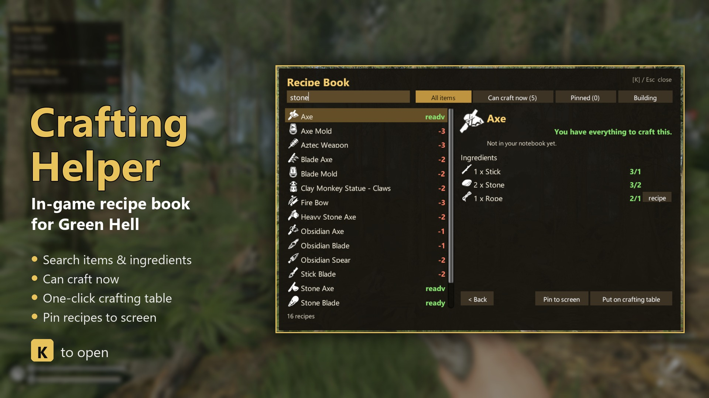

# Crafting Helper (Green Hell)

[English](README.md) | [Русский](README.ru.md) | **Polski**



W Green Hell nie da się podejrzeć przepisu, dopóki go nie wytworzysz. Częsta skarga w świeżych negatywnych recenzjach
na Steam: żeby wiedzieć, co położyć na stole rzemieślniczym, trzeba mieć wiki albo YouTube na drugim ekranie.

Crafting Helper dodaje do gry **księgę przepisów**:

| | |
|---|---|
| **K** | Otwórz / zamknij księgę przepisów (w każdej chwili: podczas chodzenia lub z otwartym plecakiem). |
| **Szukaj** | Wpisz przedmiot **lub składnik**: „kamień” znajdzie każdy przepis, który używa kamienia. |
| **Można zrobić teraz** | Pokazuje tylko to, co możesz zrobić od razu z plecaka (i z tego, co trzymasz). |
| **Składniki** | Pokazuje `masz / potrzeba` dla każdego składnika. Jeśli składnik ma własny przepis, kliknij **przepis**, aby do niego przejść. Lista **Używane do** pokazuje, do czego służy przedmiot. |
| **Połóż na stole** | Jedno kliknięcie kładzie wszystkie składniki na stole rzemieślniczym, także ciężkie przedmioty, które niesiesz, np. długie kije. Potem wystarczy nacisnąć **Wytwórz**. |
| **Przypnij do ekranu** | Przypnij do 5 przepisów. Zostają na ekranie z bieżącymi licznikami `masz / potrzeba`, gdy zbierasz. |
| **Budowanie** | Konstrukcje (schronienia, ognisko, stojaki...) z tym, czego wymagają. |

- Zablokowane przepisy (plany, których nie znalazłeś) są oznaczone jako **zablokowane**.
- Używa nazw i ikon przedmiotów z samej gry, więc podąża za językiem gry. Własne teksty moda są po angielsku
  i rosyjsku.
- Esc najpierw czyści wyszukiwanie, potem zamyka księgę. Gdy księga jest otwarta, klawisze nie wywołują akcji gry.

## Instalacja
1. Zainstaluj **BepInEx 5** (x64): pobierz `BepInEx_win_x64_5.4.23.x.zip` z
   [wydań BepInEx](https://github.com/BepInEx/BepInEx/releases) i rozpakuj do folderu Green Hell (obok `GH.exe`).
   Uruchom grę raz i wyjdź.
2. Skopiuj folder `GreenHellCraftingHelper` do `Green Hell\BepInEx\plugins\`.
3. Uruchom grę i naciśnij **K**.

## Ustawienia
`Green Hell\BepInEx\config\immortalsouul.greenhell.craftinghelper.cfg` (tworzony po pierwszym uruchomieniu):
- `OpenRecipeBook`: klawisz (domyślnie `K`).
- `ShowAllRecipes`: `true` pokazuje każdy przepis w grze. `false` pokazuje tylko przepisy już zapisane w notatniku
  (bez spoilerów).
- `Scale`: skala interfejsu (`0` = automatyczna).
- `ShowBackpackHint`: mała podpowiedź „[K] Księga przepisów” przy otwartym plecaku.

## Zgodność
- Sprawdzone na Green Hell **v2.9.5** (build 114117), Przetrwanie, gra jednoosobowa.
- Nie zmienia żadnych plików gry i nie dotyka Twoich zapisów. Przypięte przepisy są zapisywane w pliku konfiguracji.
- Gra wieloosobowa nie była sprawdzana. Przycisk stołu rzemieślniczego wykonuje te same kroki co akcja „Wytwórz”
  gry, więc powinien działać u każdego gracza, który ma mod.

## Budowanie ze źródeł
Wymaga .NET SDK. Ustaw `GamePath`, jeśli Green Hell nie jest w domyślnym folderze Steam:
```
dotnet build src -c Release -p:GamePath="D:\Steam\steamapps\common\Green Hell"
```
DLL jest automatycznie kopiowany do `BepInEx\plugins\GreenHellCraftingHelper`.

## Odinstalowanie
Usuń `BepInEx\plugins\GreenHellCraftingHelper`.

## Podziękowania
- Mod stworzony przez Claude (AI od Anthropic) dla [immortalsouul](https://www.nexusmods.com/profile/immortalsouul),
  który go publikuje.
- BepInEx i HarmonyX — zespół BepInEx.
- Green Hell — Creepy Jar.

Tłumaczenie przygotowane przy pomocy AI.

## Licencja
MIT (zob. `LICENSE`). To repozytorium nie zawiera plików gry.
