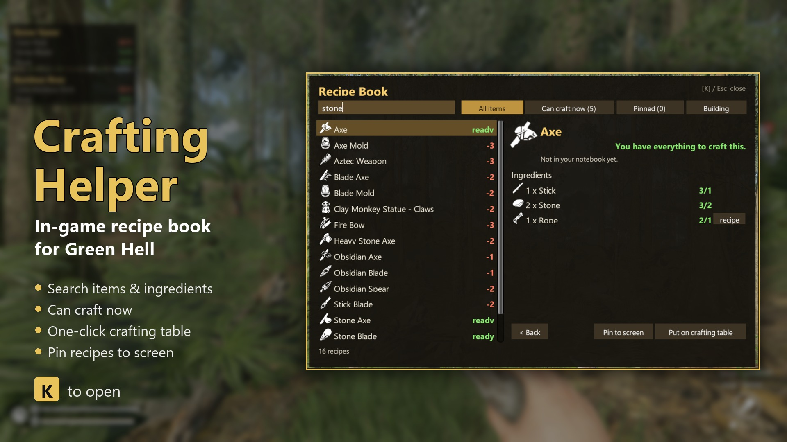

# Crafting Helper (Green Hell)

[English](README.md) | **Русский**



В Green Hell нельзя посмотреть рецепт, пока вы его не скрафтили. Частая жалоба в свежих негативных отзывах в
Steam: чтобы понять, что класть на стол крафта, приходится держать вики или YouTube на втором экране.

Crafting Helper добавляет в игру **книгу рецептов**:

| | |
|---|---|
| **K** | Открыть / закрыть книгу рецептов (в любой момент: на ходу или с открытым рюкзаком). |
| **Поиск** | Введите предмет **или ингредиент**: «камень» найдёт все рецепты, где нужен камень. |
| **Можно скрафтить** | Показывает только то, что можно сделать прямо сейчас из рюкзака (и того, что в руках). |
| **Ингредиенты** | Для каждого ингредиента показано `есть / нужно`. Если у ингредиента есть свой рецепт, нажмите **рецепт**, чтобы перейти к нему. Список **Используется в** показывает, для чего нужен предмет. |
| **Выложить на стол** | Одним нажатием кладёт все ингредиенты на стол крафта, включая тяжёлые предметы в руках, например длинные палки. Остаётся нажать **Создать**. |
| **Закрепить** | Закрепите до 5 рецептов. Они остаются на экране и показывают `есть / нужно`, пока вы собираете ресурсы. |
| **Постройки** | Постройки (укрытия, костры, стойки...) и что для них нужно. |

- Закрытые рецепты (чертежи, которые вы ещё не нашли) помечены как **закрыто**.
- Названия и иконки предметов берутся из самой игры, поэтому меняются вместе с её языком. Интерфейс мода на
  английском и русском.
- Esc сначала очищает поиск, потом закрывает книгу. Пока книга открыта, клавиши не вызывают игровые действия.

## Установка
1. Установите **BepInEx 5** (x64): скачайте `BepInEx_win_x64_5.4.23.x.zip` со
   [страницы релизов BepInEx](https://github.com/BepInEx/BepInEx/releases) и распакуйте в папку Green Hell (рядом
   с `GH.exe`). Запустите игру один раз и выйдите.
2. Скопируйте папку `GreenHellCraftingHelper` в `Green Hell\BepInEx\plugins\`.
3. Запустите игру и нажмите **K**.

## Настройки
`Green Hell\BepInEx\config\immortalsouul.greenhell.craftinghelper.cfg` (появляется после первого запуска):
- `OpenRecipeBook`: горячая клавиша (по умолчанию `K`).
- `ShowAllRecipes`: `true` показывает все рецепты игры. `false` показывает только рецепты, которые уже есть в
  блокноте (без спойлеров).
- `Scale`: масштаб интерфейса (`0` = автоматически).
- `ShowBackpackHint`: маленькая подсказка «[K] Книга рецептов» при открытом рюкзаке.

## Совместимость
- Проверено на Green Hell **v2.9.5** (build 114117), режим «Выживание», одиночная игра.
- Мод не меняет файлы игры и не трогает сохранения. Закреплённые рецепты хранятся в файле настроек.
- Мультиплеер не проверен. Кнопка «Выложить на стол» делает те же шаги, что и обычное действие «Создать» в игре,
  поэтому должна работать у каждого игрока, у которого стоит мод.

## Сборка из исходников
Нужен .NET SDK. Если Green Hell не в стандартной папке Steam, укажите `GamePath`:
```
dotnet build src -c Release -p:GamePath="D:\Steam\steamapps\common\Green Hell"
```
DLL автоматически копируется в `BepInEx\plugins\GreenHellCraftingHelper`.

## Удаление
Удалите папку `BepInEx\plugins\GreenHellCraftingHelper`.

## Благодарности
- Мод создан Claude (ИИ от Anthropic) для [immortalsouul](https://www.nexusmods.com/profile/immortalsouul), который
  его публикует.
- BepInEx и HarmonyX — команда BepInEx.
- Green Hell — Creepy Jar.

## Лицензия
MIT (см. `LICENSE`). В репозитории нет файлов игры.
